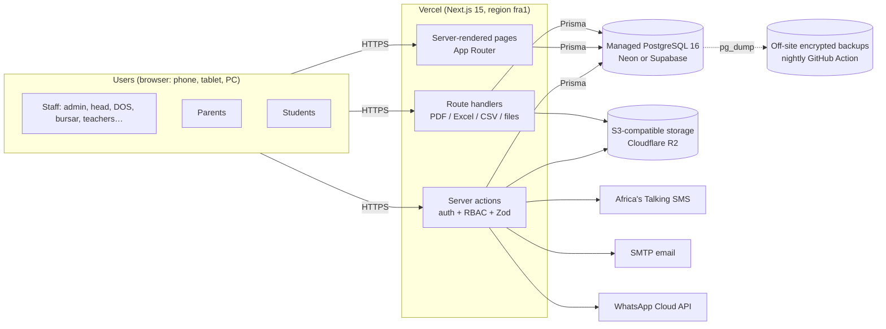

# Architecture — Bishop Ogez High School SMIS

## 1. System architecture



**Design principles**

| Concern | Decision |
|---|---|
| Rendering | Server-rendered pages; tables filter/sort/paginate through the URL so they work on slow connections (first-load JS ≈ 102–138 KB per page). |
| Business logic | Server only: every mutation is a server action wrapped by `action()` (`src/server/action.ts`) which authenticates, checks permissions, validates with Zod, maps errors and audits. |
| Authorisation | Permission codes (`src/lib/permissions.ts`) stored in the DB per role; users may hold several roles. Checked on the server for every page (`requirePage`), action and route. Row-level rules (teacher allocations, parent→child links) are enforced in the services. |
| Sessions | Random 256-bit token in an `HttpOnly`, `Secure`, `SameSite=Lax` cookie; only its SHA-256 is stored. 12-hour sliding expiry. Deactivation and role changes apply on the next request. |
| Money | `Decimal(14,2)` UGX. Append-only `LedgerEntry`; balance = Σdebit − Σcredit. Database triggers forbid UPDATE/DELETE on payments, reversals, adjustments, invoices, ledger and the audit log. |
| Exams | Pure, unit-tested engine (`src/lib/exams/engine.ts`) for grading, aggregates, divisions and ranking; all rules are configuration (grading scales, ranking basis, ties, absent policy, best-N, top-N). Results are stored as a snapshot per exam for history. |
| Files | Stored privately (local disk in development, S3/R2 in production); served only through `/api/files/[id]` with a permission check; type verified by magic bytes. |
| Reports | One engine (`src/server/reports/table.tsx`) renders any table as branded PDF, Excel or CSV with title, generation time and the generating user; every download is audited. |

## 2. Entity relationship diagram (core)

```mermaid
erDiagram
  User ||--o{ UserRole : has
  Role ||--o{ UserRole : ""
  Role ||--o{ RolePermission : grants
  Permission ||--o{ RolePermission : ""
  User |o--o| Staff : "is"
  User |o--o| Guardian : "is (parent portal)"
  User |o--o| Student : "is (student portal)"

  AcademicYear ||--|{ Term : has
  SchoolClass ||--|{ Stream : has
  Stream }o--o| Staff : "class teacher"
  Student }o--|| SchoolClass : "current class"
  Student }o--|| Stream : "current stream"
  Student ||--o{ Enrollment : "class history per year"
  Student ||--o{ StudentGuardian : ""
  Guardian ||--o{ StudentGuardian : ""
  Student ||--o{ StudentSubject : "takes (per year)"
  Subject ||--o{ StudentSubject : ""
  SubjectCombination ||--o{ CombinationSubject : ""
  TeacherAllocation }o--|| Staff : ""
  TeacherAllocation }o--|| Subject : ""
  TeacherAllocation }o--|| Stream : ""

  Exam }o--|| Term : ""
  Exam }o--|| ExamType : ""
  Exam ||--o{ ExamClass : ""
  Exam ||--o{ ExamSubject : "max marks"
  Exam ||--o{ ExamComponent : "weighted formula"
  Exam ||--o{ Mark : ""
  Exam ||--o{ MarkSubmission : "per stream+subject"
  Exam ||--o{ ExamResult : "snapshot"
  Exam ||--o{ SubjectResult : "snapshot"
  GradingScale ||--|{ GradeBand : ""

  FeeStructure ||--|{ FeeStructureItem : ""
  Student ||--o{ Invoice : ""
  Invoice ||--|{ InvoiceLine : ""
  Student ||--o{ Payment : ""
  Payment |o--o| PaymentReversal : ""
  Student ||--o{ FeeAdjustment : ""
  Student ||--o{ LedgerEntry : "append-only"

  Expense }o--|| ExpenseCategory : ""
  Expense }o--o| Supplier : ""
  PurchaseOrder ||--|{ PurchaseOrderItem : ""
  Staff ||--o{ PayrollRecord : ""
  Staff ||--o{ LeaveRequest : ""
  Student ||--o{ StudentAttendance : ""
  Staff ||--o{ StaffAttendance : ""
  Book ||--o{ LibraryLoan : ""
  InventoryItem ||--o{ StockMovement : ""
  TransportRoute ||--o{ StudentTransport : ""
  Student ||--o{ UnebCandidate : ""
  User ||--o{ AuditLog : ""
```



The full schema (≈70 tables) is `prisma/schema.prisma`; migrations are in `prisma/migrations/`.

## 3. Folder structure

```
prisma/
  schema.prisma            database schema (single source of truth)
  migrations/              SQL migrations (incl. immutability triggers)
  seed.ts                  production-safe configuration seed (idempotent)
  demo-data.ts             training/demo data — refuses non-local databases
src/
  app/
    (auth)/                login, forgot/reset/change password
    (app)/                 staff application (sidebar shell) — one folder per module
    portal/                parent and student portals
    api/                   files, PDFs, Excel/CSV reports, templates, backup export
  components/              UI kit (shadcn-style), forms, tables, charts, portal views
  lib/                     pure logic: exam engine, fees maths, payroll, permissions, nav, utils
  server/
    actions/               server actions per module ("use server" — actions only)
    exams/ fees/ imports/  domain services used by actions and routes
    reports/               PDF kit, report cards, generic table reports
    auth.ts session, RBAC  ·  audit.ts  ·  messaging.ts  ·  storage.ts  ·  counters.ts
scripts/                   backup.sh, restore.sh, acceptance.sh
tests/
  unit/                    engine, fees, payroll, date parsing
  integration/             database tests (fees ledger, exams, imports, RBAC, action safety)
  acceptance/              browser acceptance runner (brief §30)
docs/                      this documentation
```

## 4. Development roadmap and status

| Phase | Scope | Status |
|---|---|---|
| 1 Foundation | Project, schema & migrations, auth (login, reset, change, lockout, history), roles & permissions, settings, years/terms, classes/streams | Done |
| 2 Students & staff | Registration, guardians & portal accounts, profiles, promotion, transfers, withdrawals, staff & HR records, subjects, combinations, allocations, Excel imports | Done |
| 3 Examinations | Exam setup, marks entry/approval/corrections, Excel marks import, grading, ranking, combined exams, analysis, report cards | Done |
| 4 Finance | Fee structures, billing, payments, receipts, reversals, adjustments, statements, accounting, vouchers, POs, petty cash, budgets, reports | Done |
| 5 Operations | Attendance, timetables, library, inventory, discipline & welfare, transport, UNEB, HR leave & payroll | Done |
| 6 Portals | Parent & student portals, announcements, calendar, messaging, assignments & materials, role dashboards | Done |
| 7 Testing & deployment | 51 automated tests, 19/19 acceptance checks, CI, backup/restore, documentation, Vercel config | Done locally; **production deployment needs the school's accounts** (see DEPLOYMENT.md) |

Post-launch backlog (not built): mobile-money payment *collection* APIs (MTN MoMo / Airtel Money collections with automatic reconciliation), 2-factor authentication for staff, SMS delivery-report webhooks, offline marks entry, timetable auto-generation.

## 5. Phase 1 plan (as executed)

1. Next.js + TypeScript + Tailwind project with pinned stable versions.
2. Normalised PostgreSQL schema for every module; initial migration plus an immutability migration (triggers, CHECK constraints, single current year/term).
3. Session authentication with hashed tokens, bcrypt (cost 12) passwords, lockout after 5 failures/15 min per user (30 per IP), login history, password reset by email token, forced change of temporary passwords.
4. Permission catalogue and 14 default roles editable from Settings; server-side checks on pages, actions and routes.
5. Settings: school profile and logo, years & terms (current-term switch), classes & streams, grading scales, ranking rules, lists, users, roles, audit.
6. Seed with school contacts (www.bishopogez.com · ogezhigh@gmail.com · +256 772 314 931), S1–S6, subjects, combinations and scales.
7. Unit tests for the exam engine and fees maths before building on them.
